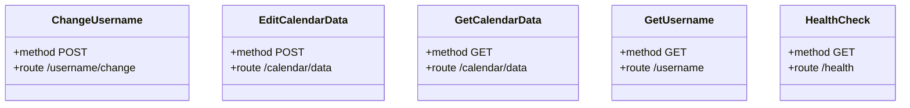

<!-- @generated by codegen-engine. Do not edit. -->
# api endpoints

- [ChangeUsername](./ChangeUsername.md)
- [EditCalendarData](./EditCalendarData.md)
- [GetCalendarData](./GetCalendarData.md)
- [GetUsername](./GetUsername.md)
- [HealthCheck](./HealthCheck.md)
