# api endpoints

```mermaid
classDiagram
  class HealthCheck {
    +method GET
    +route /health
  }
  class ProductSearch {
    +method GET
    +route /search
  }
  class SearchAuto {
    +method GET
    +route /search/auto
  }
  class CreateUser {
    +method POST
    +route /users
  }
  class ConfirmEmail {
    +method GET
    +route /users/confirm
  }
  class LoginUser {
    +method PUT
    +route /auth/session
  }
  class RefreshToken {
    +method PATCH
    +route /auth/session
  }
  class LogoutUser {
    +method DELETE
    +route /auth/session
  }
  class GetCurrentUser {
    +method GET
    +route /users/me
  }
  class SubmitUserEvents {
    +method POST
    +route /users/me/events
  }
  class GetTrackingPreference {
    +method GET
    +route /users/me/tracking
  }
  class SetTrackingPreference {
    +method PUT
    +route /users/me/tracking
  }
  class SubmitOnboarding {
    +method POST
    +route /users/me/onboarding
  }
  class SkipOnboarding {
    +method POST
    +route /users/me/onboarding/skip
  }
  class GetGenres {
    +method GET
    +route /onboarding/genres
  }
  class GetArtistsByGenre {
    +method GET
    +route /onboarding/artists
  }
  class GetFeed {
    +method GET
    +route /users/me/feed
  }
  class TrendingFeed {
    +method GET
    +route /trending
  }
  class GetTasteProfile {
    +method GET
    +route /users/me/taste
  }
  class GetRecentProducts {
    +method GET
    +route /users/me/recent
  }
  class ExportUserData {
    +method GET
    +route /users/me/data
  }
  class DeleteUserData {
    +method DELETE
    +route /users/me/data
  }
  class DeleteAccount {
    +method DELETE
    +route /users/me
  }
  class CreateShoplist {
    +method POST
    +route /shoplists
  }
  class GetShoplists {
    +method GET
    +route /shoplists
  }
  class GetShoplist {
    +method GET
    +route /shoplists/shared
  }
  class CopyShoplist {
    +method POST
    +route /shoplists/copy
  }
  class UpdateShoplist {
    +method PATCH
    +route /shoplists
  }
  class SetShoplistVisibility {
    +method PATCH
    +route /shoplists/visibility
  }
  class DeleteShoplist {
    +method DELETE
    +route /shoplists
  }
  class AddShoplistItem {
    +method POST
    +route /shoplists/items
  }
  class RemoveShoplistItem {
    +method DELETE
    +route /shoplists/items
  }
```

- [HealthCheck](./HealthCheck.md)
- [ProductSearch](./ProductSearch.md)
- [SearchAuto](./SearchAuto.md)
- [CreateUser](./CreateUser.md)
- [ConfirmEmail](./ConfirmEmail.md)
- [LoginUser](./LoginUser.md)
- [RefreshToken](./RefreshToken.md)
- [LogoutUser](./LogoutUser.md)
- [GetCurrentUser](./GetCurrentUser.md)
- [SubmitUserEvents](./SubmitUserEvents.md)
- [GetTrackingPreference](./GetTrackingPreference.md)
- [SetTrackingPreference](./SetTrackingPreference.md)
- [SubmitOnboarding](./SubmitOnboarding.md)
- [SkipOnboarding](./SkipOnboarding.md)
- [GetGenres](./GetGenres.md)
- [GetArtistsByGenre](./GetArtistsByGenre.md)
- [GetFeed](./GetFeed.md)
- [TrendingFeed](./TrendingFeed.md)
- [GetTasteProfile](./GetTasteProfile.md)
- [GetRecentProducts](./GetRecentProducts.md)
- [ExportUserData](./ExportUserData.md)
- [DeleteUserData](./DeleteUserData.md)
- [DeleteAccount](./DeleteAccount.md)
- [CreateShoplist](./CreateShoplist.md)
- [GetShoplists](./GetShoplists.md)
- [GetShoplist](./GetShoplist.md)
- [CopyShoplist](./CopyShoplist.md)
- [UpdateShoplist](./UpdateShoplist.md)
- [SetShoplistVisibility](./SetShoplistVisibility.md)
- [DeleteShoplist](./DeleteShoplist.md)
- [AddShoplistItem](./AddShoplistItem.md)
- [RemoveShoplistItem](./RemoveShoplistItem.md)
